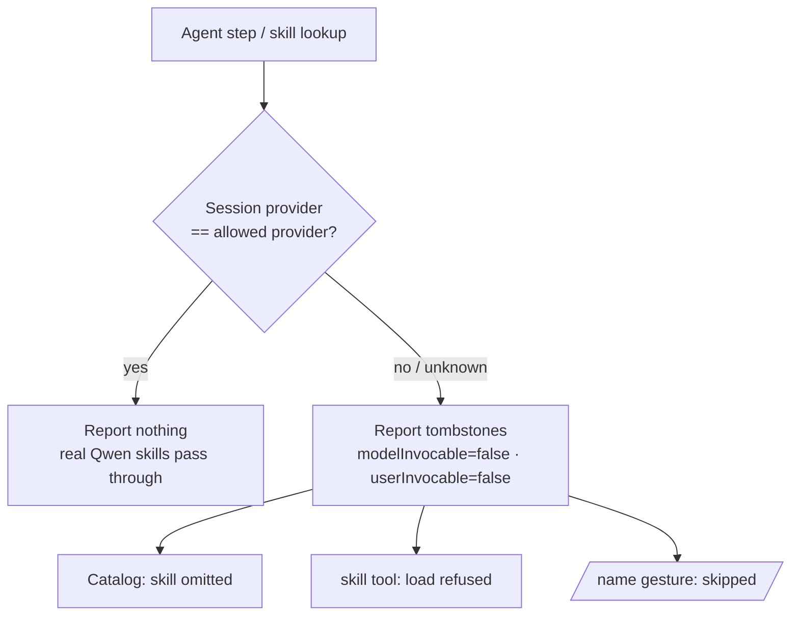

# dsh-qwen-skill-gate

**Keep Qwen skills out of non‑Qwen sessions.** A [DeepSeek Harness](https://github.com/deepseek-ai/deepseek-harness) (`dsh`) plugin that exposes the Qwen (`qianwen*`) skills **only while the session runs on the Qwen Token Plan CN provider** — and hides *and* blocks them on every other provider.

[](https://www.npmjs.com/package/dsh-qwen-skill-gate)
[](./LICENSE)
[](https://github.com/deepseek-ai/deepseek-harness)

English | [简体中文](./README.zh-CN.md)

---

## The problem it solves

If you install the [QianWen skill pack](https://github.com/QianWen-AI/qianwen-ai) (`qianwen-text`, `qianwen-vision`, `qianwenai-deploy`, …), those skills are advertised to **every** session, no matter which model you are actually running. On a non‑Qwen model they are dead weight at best — and at worst the model loads one and injects a wall of Qwen‑specific instructions into your context, polluting the conversation and burning tokens.

The usual workaround is to paste a "only use this on Qwen" warning into each `SKILL.md`. That is an *instruction‑level* gate: it relies on the model reading and obeying the note. This plugin replaces it with a **harness‑level** gate — the skills are simply not offered, and cannot be loaded, unless the provider matches.

## What it does

For each agent, the plugin watches the session's model provider. When the provider is **not** the allowed one (default `qwen-token-plan-cn`), it shadows every matching skill with a locked "tombstone" entry. Because `dsh`'s skill consumer filters on the invocation flags, one mechanism gates all three surfaces at once:

| Surface | Behavior on a non‑allowed provider |
|---|---|
| Session skill catalog | the skill is **omitted** from the list the model sees |
| `skill` loader tool | returns `Error: skill "<name>" is not available for model invocation` |
| `/name` user gesture | the injection is **skipped** |

On the allowed provider the plugin reports nothing, so the real skills pass through **untouched** — live bodies, resource guidance, and file watching all preserved.



## Install

**From the plugin market (recommended).** In DeepSeek Harness open **Plugins → Discover** and search for `dsh-qwen-skill-gate`, or add the community index if you haven't already:

```
https://cdn.jsdelivr.net/npm/dsh-plugin-catalog/index.json
```

**From the CLI:**

```sh
dsh plugin add dsh-qwen-skill-gate
# or target a specific profile:
dsh plugin --profile <your-profile> add dsh-qwen-skill-gate
```

**From npm directly:**

```sh
npm install dsh-qwen-skill-gate
```

The plugin is Host‑only: no dependencies, no client module, no build step. It activates automatically and applies to every session in the profile.

## Configuration

Defaults are shipped in the bundle's `cordis.patch.yml`. Override them in your profile's `cordis.patch.yml` by targeting the row id `dsh-qwen-skill-gate` (a config override replaces the whole `config`, so restate the fields you need):

```yaml
- id: dsh-qwen-skill-gate
  name: dsh-qwen-skill-gate
  config:
    provider: qwen-token-plan-cn   # the only provider allowed to see/load gated skills
    prefixes: [qianwen]            # skill-name prefixes to gate
    skills: []                     # extra exact skill names to gate
    failClosed: true               # hide gated skills when the provider can't be determined
```

| Field | Default | Meaning |
|---|---|---|
| `provider` | `qwen-token-plan-cn` | The only provider allowed to see / load the gated skills. |
| `prefixes` | `["qianwen"]` | Skill‑name prefixes to gate. The default covers both `qianwen-*` and `qianwenai-*`. |
| `skills` | `[]` | Additional exact skill names to gate, on top of the prefixes. |
| `failClosed` | `true` | If the session's provider cannot be determined, hide the gated skills (fail safe). |

### Skills gated by default

The 14 skills of the QianWen pack: `qianwen-text`, `qianwen-vision`, `qianwen-image-generation`, `qianwen-video-generation`, `qianwen-audio-tts`, `qianwen-model-selector`, `qianwen-ops-auth`, `qianwen-usage`, `qianwen-payment`, `qianwen-find-skills`, `qianwen-update-check`, `qianwenai-deploy`, `qianwenai-observe`, `qianwenai-operate`.

Any future skill whose name starts with a configured prefix is gated automatically.

## Behavior at a glance

| Session provider | Catalog | `skill` load |
|---|---|---|
| `qwen-token-plan-cn` | all skills visible | allowed |
| any other provider | gated skills hidden | refused |
| provider unknown | gated skills hidden (`failClosed`) | refused |

Switching the model mid‑session is handled: the gate re‑evaluates on the next step and the catalog is refreshed, in both directions.

## How it works (under the hood)

The plugin registers one skill provider **per agent**, in that agent's scoped context. `dsh` composes the filesystem skills per agent and lets the *nearest* scope layer win a name, so the gate lives in that same nearest layer and shadows the real entries with a lower rank.

Key implementation constraints:

- **Providers must be async.** The registry races `list()`/`get()` against the lookup signal via `promise.then`; a synchronous return is rejected, the provider is skipped, and discovery is marked incomplete.
- **Global registration is not enough.** A global provider sits in a farther layer than the per‑agent filesystem skills and loses the name merge. The gate must be registered per agent.
- **The provider name is unique per module generation** (`qwen-gate-<suffix>`). Reinstalling a linked bundle loads a new module generation, but the previous generation's per‑agent registrations can leak. With a fixed name the new generation's registration fails ("already registered in this scope"), it loses its `invalidate()` handle, and a later model switch can no longer refresh the registry cache. A unique name lets each generation register alongside any leaked ones, so the active generation always holds a working invalidate handle and the gate self‑heals across reinstalls. Restarting the app clears leaked generations.
- **The decision follows the viewer.** `list()` reads the *viewing* agent's provider (`options.scope`), not the agent the provider was registered for, because the registry also consults an ancestor's provider when snapshotting a descendant's catalog.

The current provider is read from `agent.model.current()` (the same source the agent loop uses for a step's selection), falling back to the session's `modelSelection` projection and then the global default. The registry caches catalogs per `(cwd, scope, revision)`; a `session/event` listener invalidates the cache only when a session's gate state actually flips.

## Limitations

- **It gates skills, not files.** The Qwen skill scripts still exist on disk; a model could in principle run them via a shell tool. Nothing advertises that path, but this is a skill‑registry boundary, not a filesystem/credential control.
- **Default roots only.** Name discovery scans the default skill roots (project `.dsh/skills` and `.agents/skills`, `$DSH_HOME/skills`, `~/.agents/skills`). Skills placed only in a custom root configured on `dsh-skill-filesystem` are not auto‑discovered — add them to `skills` explicitly.
- **Transient "discovery incomplete" notice.** Registering a provider invalidates the shared catalog cache; a concurrent read can briefly report incomplete discovery. It self‑corrects on the next request and loses nothing.

## Compatibility

- DeepSeek Harness `0.2.x` (uses the `ctx.skills` provider registry, per‑agent scope layers, and `agent.model.current()`).
- Host‑only; works in the Web GUI and headless. No browser UI.

## Development

The plugin is a single plain‑JS module (`index.js`) plus a bundle patch, locale files, and an icon. To iterate locally, install the checkout as a bundle with the plugin manager, then reload. See the implementation notes above before changing the registration or provider shape.

## Release notes

| Version | Changes |
|---|---|
| 1.0.0 | Initial release. Provider‑gated Qwen skills across the catalog, `skill` tool, and `/name` gesture; per‑agent async provider with a generation‑unique name; configurable `provider` / `prefixes` / `skills` / `failClosed`; bilingual documentation. |

## License

[MIT](./LICENSE) © PaysNatal

---

<sub>Not affiliated with the QianWen skill pack or Alibaba Cloud. "Qwen" and related names belong to their respective owners.</sub>