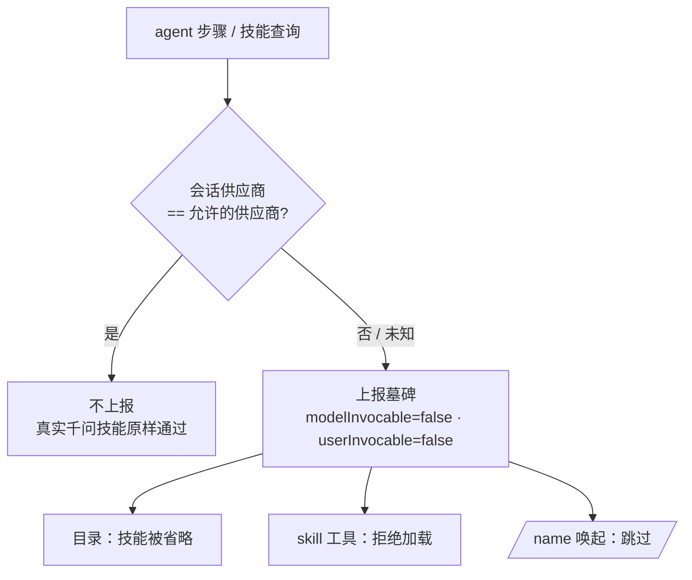

# dsh-qwen-skill-gate

**让千问技能只留在千问会话里。** 这是一个 [DeepSeek Harness](https://github.com/deepseek-ai/deepseek-harness)（`dsh`）插件：只有当会话运行在 **Qwen Token Plan CN** 供应商上时，才展示千问（`qianwen*`）技能；切换到其它任何供应商时，这些技能会被**隐藏并禁止加载**。

[](https://www.npmjs.com/package/dsh-qwen-skill-gate)
[](./LICENSE)
[](https://github.com/deepseek-ai/deepseek-harness)

[English](./README.md) | 简体中文

---

## 解决什么问题

如果你装了 [千问技能包](https://github.com/QianWen-AI/qianwen-ai)（`qianwen-text`、`qianwen-vision`、`qianwenai-deploy`……），这些技能会出现在**每一个**会话里，不管你当前跑的是哪个模型。在非千问模型上，它们轻则是无用负担，重则被模型加载、把一大段千问专用指令塞进上下文，污染对话、浪费 token。

常见做法是在每个 `SKILL.md` 里贴一句「仅限千问使用」的警告。那是**指令级**门禁——靠模型读到并自觉遵守。本插件把它换成 **harness 级**门禁：供应商不匹配时，技能压根不会被提供，也无法被加载。

## 它做了什么

插件为每个 agent 监听会话的模型供应商。当供应商**不是**允许的那个（默认 `qwen-token-plan-cn`）时，就用一条「已上锁」的墓碑条目把每个匹配的技能盖掉。由于 `dsh` 的技能消费端按调用标志过滤，一个机制同时管住三个入口：

| 入口 | 非允许供应商下的表现 |
|---|---|
| 会话技能目录 | 该技能从模型看到的列表里**消失** |
| `skill` 加载工具 | 返回 `Error: skill "<name>" is not available for model invocation` |
| `/name` 手动唤起 | 注入被**跳过** |

在允许的供应商上，插件不上报任何东西，真实技能**原样通过**——实时正文、资源指引、文件监听全部保留。



## 安装

**从插件市场（推荐）。** 在 DeepSeek Harness 里打开 **Plugins → Discover**，搜索 `dsh-qwen-skill-gate`；如果还没添加社区索引，先加上：

```
https://cdn.jsdelivr.net/npm/dsh-plugin-catalog/index.json
```

**命令行：**

```sh
dsh plugin add dsh-qwen-skill-gate
# 或指定 profile：
dsh plugin --profile <你的profile> add dsh-qwen-skill-gate
```

**直接从 npm：**

```sh
npm install dsh-qwen-skill-gate
```

纯 Host 插件：无依赖、无前端模块、无构建步骤。装好即自动生效，作用于该 profile 的所有会话。

## 配置

默认值随包的 `cordis.patch.yml` 一起发布。要改，就在你 profile 的 `cordis.patch.yml` 里按行 id `dsh-qwen-skill-gate` 覆盖（config 覆盖是整段替换，需要的字段请一并写上）：

```yaml
- id: dsh-qwen-skill-gate
  name: dsh-qwen-skill-gate
  config:
    provider: qwen-token-plan-cn   # 唯一允许看到/加载被门禁技能的供应商
    prefixes: [qianwen]            # 要门禁的技能名前缀
    skills: []                     # 额外按精确名字门禁的技能
    failClosed: true               # 判断不了供应商时，隐藏被门禁技能
```

| 字段 | 默认 | 含义 |
|---|---|---|
| `provider` | `qwen-token-plan-cn` | 唯一允许看到 / 加载被门禁技能的供应商。 |
| `prefixes` | `["qianwen"]` | 要门禁的技能名前缀，默认同时覆盖 `qianwen-*` 和 `qianwenai-*`。 |
| `skills` | `[]` | 在前缀之外，额外按精确名字门禁的技能。 |
| `failClosed` | `true` | 无法确定会话供应商时，隐藏被门禁技能（安全兜底）。 |

### 默认门禁的技能

千问技能包的 14 个技能：`qianwen-text`、`qianwen-vision`、`qianwen-image-generation`、`qianwen-video-generation`、`qianwen-audio-tts`、`qianwen-model-selector`、`qianwen-ops-auth`、`qianwen-usage`、`qianwen-payment`、`qianwen-find-skills`、`qianwen-update-check`、`qianwenai-deploy`、`qianwenai-observe`、`qianwenai-operate`。

以后任何名字以配置前缀开头的新技能都会被自动门禁。

## 行为一览

| 会话供应商 | 目录 | `skill` 加载 |
|---|---|---|
| `qwen-token-plan-cn` | 全部技能可见 | 允许 |
| 其它任何供应商 | 被门禁技能隐藏 | 拒绝 |
| 供应商未知 | 被门禁技能隐藏（`failClosed`） | 拒绝 |

会话中途切换模型也能正确处理：门禁在下一步重新判定并刷新目录，双向都生效。

## 原理（深入一点）

插件为**每个 agent** 在其作用域上下文里注册一个技能 provider。`dsh` 按 agent 组装文件系统技能，并让**最近**的作用域层赢得同名条目，所以门禁就挂在那个最近层、用更低的 rank 把真实条目盖掉。

几个关键实现约束（已固化进设计）：

- **provider 必须是 async。** 注册表用 `promise.then` 把 `list()`/`get()` 与查询信号竞速；同步返回会被拒收、provider 被跳过，并把发现标记为不完整。
- **只挂全局不够。** 全局 provider 位于比「按 agent 的文件系统技能」更远的层，会输掉同名合并。门禁必须按 agent 注册。
- **provider 名字按模块代唯一**（`qwen-gate-<后缀>`）。重装 link 包会加载新模块代，但旧代的按 agent 注册可能泄漏不卸载。若用固定名字，新代注册会撞名失败（"already registered in this scope"），丢掉 `invalidate()` 句柄，之后切模型就再也无法刷新注册表缓存。唯一名字让每一代都能与泄漏的旧代并存注册，当前代始终握有可用的 invalidate 句柄，门禁跨重装自愈。重启 App 可清掉泄漏的旧代。
- **判定跟随查看者。** `list()` 读的是**查看方** agent 的供应商（`options.scope`），而不是 provider 注册时所属的 agent——因为注册表在给后代 agent 快照目录时也会连带查询祖先的 provider。

当前供应商取自 `agent.model.current()`（与 agent loop 为一步选模型所用的同一来源），依次回退到会话的 `modelSelection` 投影、再到全局默认。注册表按 `(cwd, scope, revision)` 缓存目录；`session/event` 监听器只在某会话的门禁状态真正翻转时才作废缓存。

## 局限

- **门禁的是技能，不是文件。** 千问技能脚本仍在磁盘上，模型理论上可以用 shell 工具直接跑。没有任何东西引导它这么做，但这是技能注册表层面的边界，不是文件系统/凭据管控。
- **只扫默认根目录。** 名字发现扫描默认技能根（项目 `.dsh/skills`、`.agents/skills`，`$DSH_HOME/skills`，`~/.agents/skills`）。只放在 `dsh-skill-filesystem` 自定义根目录里的技能不会被自动发现——请显式加进 `skills`。
- **偶发「发现不完整」提示。** 注册 provider 会作废共享目录缓存，并发读取可能短暂报不完整；下一请求自愈，不丢任何东西。

## 兼容性

- DeepSeek Harness `0.2.x`（使用 `ctx.skills` provider 注册表、按 agent 的作用域层、`agent.model.current()`）。
- 纯 Host；Web GUI 与 headless 均可用，无浏览器 UI。

## 开发

插件就是一个纯 JS 模块（`index.js`）加 bundle patch、locale 文件和图标。本地迭代：用插件管理器把当前目录作为 bundle 安装，然后重载。改动注册方式或 provider 形态前，请先读上面的实现要点。

## 版本记录

| 版本 | 变更 |
|---|---|
| 1.0.0 | 首个版本。按供应商门禁千问技能，覆盖目录、`skill` 工具、`/name` 唤起三个入口；按 agent 的 async provider、模块代唯一名字；可配置 `provider` / `prefixes` / `skills` / `failClosed`；双语文档。 |

## 许可证

[MIT](./LICENSE) © PaysNatal

---

<sub>与千问技能包或阿里云无隶属关系。「Qwen」等名称归各自所有者。</sub>